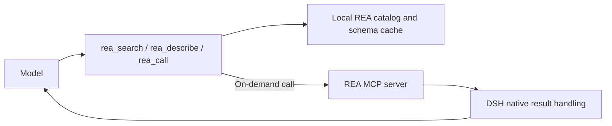

# DSH REA Gateway

[中文](README.md) · [Measurements and method](docs/benchmark.en.md) · [Fork notice](FORK-NOTICE.md)

An on-demand REA tool gateway for DeepSeek Harness (DSH). The model sees three persistent tools—`rea_search`, `rea_describe`, and `rea_call`—while full REA parameter schemas stay in a local catalog and are read when needed.

This project is derived from **[kirkchinese/dsh-capability-catalog 0.1.4](https://github.com/kirkchinese/dsh-capability-catalog)**. It retains the upstream catalog design, implementation, original attribution, and MIT license. This fork focuses on REA, with separate names, defaults, and DSH `0.2.1-rc.4` integration. See [FORK-NOTICE.md](FORK-NOTICE.md).

## Why this exists

REA 6.5.0 exposes 207 MCP tools. Including all their full schemas can fill a model's context window even when the user sends a short message.

In a reconstruction of one real failing request, the serving model's counter reported **284,483 tokens**. Removing only the REA tool definitions reduced this to **34,239 tokens**, a paired difference of **250,244 tokens**. The original error reported 287,065 tokens, leaving an unexplained difference of 2,582 tokens from the reconstruction.

Requests that repeatedly include the full definitions can incur a similar input burden. The exact amount depends on the tokenizer, tool version, chat template, and request contents. Billing also depends on caching and provider rules; the token difference is not a measured monetary saving. See the [measurement notes](docs/benchmark.en.md) for the method and limits.

## How it works



The gateway runs in DSH's tool layer. The model API follows the existing DSH model settings; REA schemas are retrieved from the local catalog as needed.

| Tool | Purpose |
| --- | --- |
| `rea_search` | Find tools by keywords, family, or source; return IDs and short summaries |
| `rea_describe` | Read a selected tool's description and parameters; expand large schemas using JSON Pointers |
| `rea_call` | Validate arguments and call the corresponding REA MCP tool |

Capability IDs keep the form `mcp:rea/<tool>`. For example, search for `binary_session`, describe `mcp:rea/binary_session`, then call it with:

```json
{"id":"mcp:rea/binary_session","arguments":{}}
```

These three tools stay fixed during a session. DSH's other native tools remain available. DSH also continues to manage its native skill catalog; skill indexing and takeover are disabled by default here.

## Installation

Requires DSH **`0.2.1-rc.4`** and a Node.js / npm setup able to run REA. Tested on Windows. Launch configuration is included for macOS and Linux, but those platforms have not been tested.

Within the same DSH profile, do not install and enable this gateway alongside the upstream capability catalog (`@kirkchinese/dsh-capability-catalog`) or `@kirkchinese/dsh-rea`. Disable or uninstall other REA integrations before installing this gateway to avoid duplicate catalogs, controls, and connections. This plugin does not migrate or disable those integrations automatically.

1. Download the prebuilt `dsh-rea-gateway-0.1.1.tgz` from [GitHub Release v0.1.1](https://github.com/MingoYung/dsh-rea-gateway/releases/tag/v0.1.1).
2. Use the **`dsh` command supplied by DSH Desktop** to install it into the desktop profile:

   ```sh
   dsh plugin --profile desktop add ./dsh-rea-gateway-0.1.1.tgz
   ```

3. Disable any previous direct REA MCP registration in DSH, such as an old `rea-mcp` entry. Keeping both registrations active continues to send the direct registration's full tool definitions.
4. Confirm that REA Gateway is enabled in the plugin page and that model requests contain the three `rea_*` tools.

GitHub Release tarballs are the distribution channel. When managing the desktop profile, use the command from the current Desktop installation; a separately installed npm CLI has different rules for managing `desktop`.

The absence of native `mcp__rea__*` tools is expected with the gateway. Use `rea_search → rea_describe → rea_call`; recreating a direct registration through REA setup would bring the full schemas back.

## Controls

| Scope | Behavior |
| --- | --- |
| Entire gateway | Enable or disable the bundle in the plugin page; advanced configuration also exposes the `config.enabled` master switch |
| Global REA state | Toggle the REA row under MCP servers in the plugin's REA Gateway settings card |
| Current session | Click REA on the left of the input box and choose Default, On, or Off |

Every control in the REA popover affects the current session, including the header actions and the options below. Global controls live in the plugin page's REA Gateway settings card.

Follow global clears all overrides for this session without changing global settings; the button is disabled when there are no overrides. Dismiss only hides the panel, preserving saved settings and the input draft. It does not cancel a save already submitted.

The entry shows only the icon and REA at a fixed 60×24 px size, with single-line text to keep the layout stable when state changes. Its border and the selected popover segment indicate the session selection: Default follows the system color, On is green, and Off is blue. The popover shows selection details, effective state, and setting source; the tooltip provides a state summary. Default follows global settings, so its effective state can still be Currently disabled.

REA state resolves in this order: **session override → global override → configured default**. Choosing default clears that override and follows the next layer. The master switch removes the three tools and catalog index. A session can explicitly enable REA while it is globally disabled.

An off state blocks calls and changes the catalog visible to that session. Overrides persist in `DSH_HOME/dsh-rea-gateway/toggles.json`. UI changes update the running state; manual edits to the file require reloading the plugin.

## 0.1.1 session-panel update

- Render the panel at the page level with a solid background so the composer container cannot cover it.
- Use Follow global and Dismiss for the header actions and make the panel's session scope explicit.
- Keep only the icon and REA in a fixed 60×24 px entry with single-line text. Default follows the system color, On is green, and Off is blue, matching the selected popover segment.
- Show state in the popover and tooltip, provide saving/result feedback, and prevent duplicate submissions. The popover can explicitly show Currently disabled while Default follows global settings.

The final local adaptation build passed interactive checks: Default followed the system color, On was green, and Off was blue; the entry stayed 60×24 px with no wrapping in all three states. Saving, Follow global, and Dismiss worked. The original Default state was restored afterward, global settings were unchanged, and the input draft was preserved. Public `0.1.1` uses the same client logic, but the public package has not been installed into production for validation; these UI checks are not a new `0.1.1` headless integration measurement. The `0.1.0` integration data below remains a historical measurement of that version.

## REA startup and caching

The default pins REA to `6.5.0`:

- Windows: `cmd.exe /d /c npx -y rea-agents@6.5.0 mcp`.
- macOS / Linux: `npx -y rea-agents@6.5.0 mcp`; neither platform has been tested.
- Cache: `DSH_HOME/dsh-rea-gateway`.
- Catalog TTL: one day. Call connections close after five idle minutes.

A valid cache serves search and describe requests. A cold or expired cache may briefly start REA to discover tools, then close the discovery connection. Calls connect on demand and disconnect after the idle timeout. `npx` uses the npm cache: the first run may download dependencies, and subsequent starts may revalidate registry metadata.

See [cordis.patch.yml](cordis.patch.yml) for the shipped defaults. A Cordis `config` override replaces the whole object; retain the `mcp`, `toolNames`, `skills`, and other fields you need. The configuration schema also permits custom launch commands and tool allow/deny lists.

## Validation and scope

Public release `0.1.0` passed **6 cases and 12 controlled headless requests**: ordinary conversation, `rea_search → rea_describe → rea_call` with a real read-only REA call, global off, session off, session on overriding global off, and master off. With the gateway enabled, its three tools totaled **2,063 UTF-8 bytes**, with no raw REA tools in the model-facing tools array. This profile had 25 native tools plus the three gateway tools; this is not a desktop tool count. Master off retained only the 25 native tools. See the [public integration results](docs/public-integration.json).

The earlier local adaptation separately passed 13 controlled requests. Its former `capability_*` tools totaled 2,098 bytes, and a real read-only REA call plus global/session overrides passed. Versions, names, and byte sizes for both samples are recorded separately in the [benchmark data](docs/benchmark.json).

Individual REA capabilities still depend on their analysis engines, platform, and tool prerequisites. Calls use DSH's native MCP result adapter. Model-visible media depend on the host and selected model's capabilities. Conversation history, output reservation, and context limits remain part of DSH's context management.

## Development and license

```sh
npm install
npm test
npm run build
```

Development dependencies must match the declared DSH rc.4 peers. Release tarballs contain the built `lib` directory and can be installed directly.

Upstream author: kirkchinese. Upstream: [dsh-capability-catalog](https://github.com/kirkchinese/dsh-capability-catalog). Fork maintenance: [MingoYung/dsh-rea-gateway](https://github.com/MingoYung/dsh-rea-gateway). License: [MIT](LICENSE).
