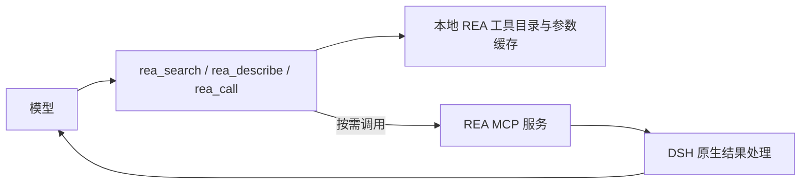

# DSH REA Gateway

[English](README.en.md) · [基准与方法](docs/benchmark.md) · [派生说明](FORK-NOTICE.md)

给 DeepSeek Harness（DSH）提供按需加载的 REA 工具入口：模型常驻看到 `rea_search`、`rea_describe`、`rea_call` 三个工具，完整 REA 参数定义保存在本地缓存，使用时再检索、查看和调用。

本项目派生自 **[kirkchinese/dsh-capability-catalog 0.1.4](https://github.com/kirkchinese/dsh-capability-catalog)**，沿用上游的能力目录设计与实现，并保留原作者及 MIT 许可。这个分支收窄到 REA，加入独立命名、默认配置与 DSH `0.2.1-rc.4` 适配；详见 [FORK-NOTICE.md](FORK-NOTICE.md)。

## 为什么做这个

REA 6.5.0 提供 207 个 MCP 工具。将它们的完整参数定义一并放入请求，可能在用户只问一句话时就占满模型上下文。

在一次实际故障请求的重建测量中，模型服务计数为 **284,483 tokens**；只移除 REA 工具定义后为 **34,239 tokens**，差额 **250,244 tokens**。这是特定请求、模型与序列化方式下的配对结果。原始错误报告为 287,065 tokens，与重建值仍差 2,582 tokens，原因未确定。

每次再次完整附带这批定义，都可能带来同量级的输入负担；实际大小取决于 tokenizer、工具版本、聊天模板和请求内容。计费还受缓存和提供方规则影响，这个差额不能直接当作费用节省。完整数字、测试边界和方法见 [基准说明](docs/benchmark.md)。

## 工作方式



插件挂在 DSH 的工具层。模型 API 继续按 DSH 的模型设置路由，完整 REA schema 通过本地目录按需读取。

| 入口 | 用途 |
| --- | --- |
| `rea_search` | 按关键词、能力族或来源寻找工具，返回 ID 和简短说明 |
| `rea_describe` | 读取选中工具的说明及参数；大 schema 支持通过 JSON Pointer 分段展开 |
| `rea_call` | 校验参数，再调用对应 REA MCP 工具 |

工具 ID 保持 `mcp:rea/<tool>` 形式。例如，先搜索 `binary_session`，查看 `mcp:rea/binary_session` 的参数，再调用：

```json
{"id":"mcp:rea/binary_session","arguments":{}}
```

这三个入口在会话内保持固定。DSH 自带工具仍照常存在；原生 skill 目录也继续由 DSH 管理。本项目默认关闭 skill 索引与接管。

## 安装

要求 DSH **`0.2.1-rc.4`**，以及可运行 REA 的 Node.js / npm。已实测 Windows；macOS 和 Linux 的启动配置已提供，尚未实测。

1. 从 [GitHub Release v0.1.1](https://github.com/MingoYung/dsh-rea-gateway/releases/tag/v0.1.1) 下载预构建包 `dsh-rea-gateway-0.1.1.tgz`。
2. 使用 **DSH Desktop 自带的 `dsh` 命令**安装到桌面 profile：

   ```sh
   dsh plugin --profile desktop add ./dsh-rea-gateway-0.1.1.tgz
   ```

3. 在 DSH 中关闭旧的 REA 直连 MCP 注册，例如原先的 `rea-mcp`。保留直连与网关两条注册，会继续把旧的全量定义送给模型。
4. 在插件页确认 REA Gateway 已启用，检查模型请求中出现三个 `rea_*` 入口。

发布渠道是 GitHub Release tarball。使用桌面 profile 时，请确认终端中的 `dsh` 来自当前 Desktop 安装；独立 npm CLI 对 `desktop` 的管理权限不同。

缺少 `mcp__rea__*` 原生工具是网关的预期状态。应使用 `rea_search → rea_describe → rea_call`，无需为恢复这些原生名字重新执行 REA setup。

## 开关

| 范围 | 操作与效果 |
| --- | --- |
| 整个网关 | 在插件页停用或启用组合包；高级配置也提供 `config.enabled` 总开关 |
| REA 全局 | 在插件设置的「REA 按需网关」卡片中，切换「MCP 服务器 → REA」开关 |
| 当前会话 | 点击输入框左侧的「REA」按钮，选择「默认 / 开 / 关」 |

「REA」弹窗内的全部控件都只作用于当前会话，包括顶部操作和下方选项；全局开关在插件页的「REA 按需网关」设置卡片中。

顶部「恢复跟随全局」清除本会话所有单独覆盖，不改变全局设置；没有覆盖时该按钮不可点击。「收起」只隐藏弹窗，保留已保存的设置和输入草稿，也不会取消已经发出的保存操作。

入口只保留图标和「REA」，尺寸固定为 60×24 px，文字保持单行，切换状态时保持布局稳定。入口边框与弹窗选中分段的颜色表示本会话选择：默认色跟随系统，「开」为绿色，「关」为蓝色。选择详情、当前生效状态与设置来源在弹窗中查看，悬停提示提供状态摘要。「默认」跟随全局，因此仍可能显示「当前已停用」。

REA 的状态优先级为 **会话覆盖 → 全局覆盖 → 配置默认值**。“默认”清除当前覆盖并沿用下一层。总开关关闭时，三个入口与索引都停止提供；REA 全局关闭时，某个会话仍可明确设为开启。

关闭状态会拦截调用，也会影响该会话可见的目录。状态保存在 `DSH_HOME/dsh-rea-gateway/toggles.json`；通过界面更改可更新运行状态，手动编辑该文件需要重新加载插件。

## 0.1.1 会话弹窗更新

- 弹窗显示在页面顶层，避免被输入框容器遮挡，并使用实底背景。
- 顶部操作改为「恢复跟随全局」和「收起」，明确整个面板的本会话范围。
- 入口只保留图标和「REA」，尺寸固定为 60×24 px、文字保持单行；默认色跟随系统，开为绿色、关为蓝色，并与弹窗选中分段对应。
- 在弹窗和悬停提示中查看状态；保存时显示进度和结果，并阻止重复提交。默认跟随全局时，弹窗仍可明确显示当前停用。

最终本地适配构建已完成实机验证：默认色跟随系统、开为绿色、关为蓝色，入口在三种状态下均保持 60×24 px 且文字不换行；保存、恢复跟随全局和收起均正常。验证后已恢复原默认状态，全局设置未改，输入草稿保留。公开版 `0.1.1` 采用同一客户端逻辑，但尚未将公开包安装到生产环境验证；这些 UI 结果不作为新的 `0.1.1` headless 集成测量。下文的 `0.1.0` 集成数据仍保留为该版本的历史测量。

## REA 启动与缓存

默认固定 REA `6.5.0`：

- Windows：`cmd.exe /d /c npx -y rea-agents@6.5.0 mcp`。
- macOS / Linux：`npx -y rea-agents@6.5.0 mcp`，这两种平台尚未实测。
- 缓存目录：`DSH_HOME/dsh-rea-gateway`。
- 工具目录 TTL：一天；调用连接空闲五分钟后断开。

有效缓存可供检索和查看参数使用。首次没有缓存或缓存过期时，插件可能短暂启动 REA 来发现工具，再关闭发现连接。实际调用时按需连接，并在空闲超时后断开。`npx` 使用 npm 缓存；首次运行可能下载依赖，后续启动可能校验缓存元数据。

默认配置见 [cordis.patch.yml](cordis.patch.yml)。手写 Cordis 覆盖时，`config` 会整体替换，请保留需要的 `mcp`、`toolNames`、`skills` 等字段。配置模式允许更换启动命令或设置工具白名单、黑名单。

## 验证与边界

公开版 `0.1.0` 已通过 **6 个用例、12 次受控 headless 请求**：普通请求、`rea_search → rea_describe → rea_call` 与真实 REA 只读调用、全局关闭、会话关闭、会话开启覆盖全局关闭、网关总开关关闭。启用网关时三个入口合计 **2,063 UTF-8 字节**，请求工具数组中没有原始 REA 工具。该环境共 25 个原生工具加三个入口，不能当作桌面 profile 的总工具数；总开关关闭后只保留 25 个原生工具。详见 [公开版集成结果](docs/public-integration.json)。

此前的本地适配版另有 13 次受控请求验收，三个旧名 `capability_*` 入口合计 2,098 字节，真实 REA 只读调用以及全局、会话开关均通过。两组样本的版本、工具名与字节数分别记录在 [基准数据](docs/benchmark.json)。

REA 的各项能力仍取决于相应分析引擎、平台及工具自身前提。调用通过 DSH 原生 MCP 结果适配器处理；多媒体能否进入模型上下文，还取决于宿主与所选模型能力。对话历史、输出预留与上下文窗口仍需由 DSH 的上下文管理控制。

## 开发与许可

```sh
npm install
npm test
npm run build
```

开发依赖需要与项目声明的 DSH rc.4 peer 版本一致。发布包包含构建后的 `lib`；终端用户可直接安装 Release 中的 tarball。

上游作者：kirkchinese。上游项目：[dsh-capability-catalog](https://github.com/kirkchinese/dsh-capability-catalog)。本分支维护：[MingoYung/dsh-rea-gateway](https://github.com/MingoYung/dsh-rea-gateway)。许可：[MIT](LICENSE)。
